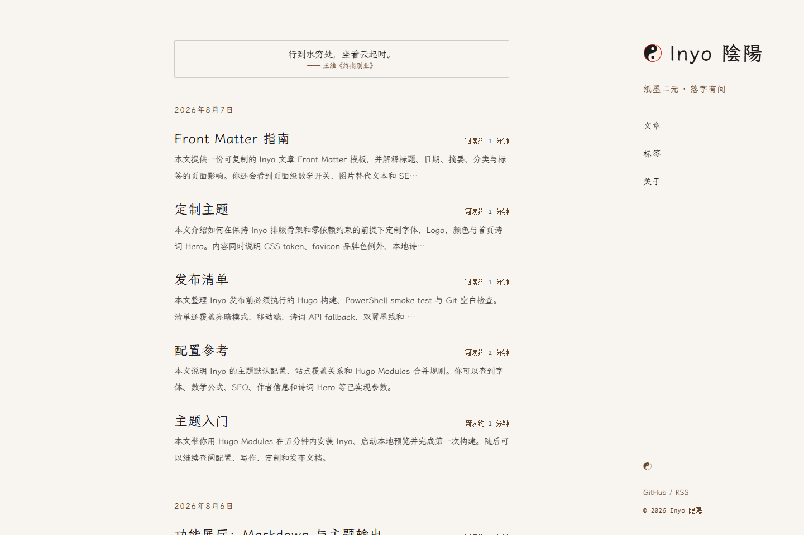

# Inyo 陰陽

[](https://github.com/FeiNiaoBF/hugo-theme-inyo/actions/workflows/verify-theme.yml)
[](LICENSE)
[](https://FeiNiaoBF.github.io/hugo-theme-inyo/)

> A Chinese-first Hugo theme for long-form reading, with paper-and-ink themes, a poetry hero, multilingual UI, page-level math, and portable navigation.

<h3 align="center">
  <a href="README.md">中文</a>
</h3>

[](https://FeiNiaoBF.github.io/hugo-theme-inyo/)

## Status

Inyo is an early usable theme for personal blogs, notes, and editorial sites. Installation examples follow the latest release through `@latest`. Use a Git tag when you need to reproduce a historical version.

| Requirement | Version |
| --- | --- |
| Hugo | Extended `>= 0.164.0` |
| Go | `>= 1.26.1` for Hugo Modules |
| Runtime | Native CSS and JavaScript; no frontend framework |

Live demo: [FeiNiaoBF.github.io/hugo-theme-inyo](https://FeiNiaoBF.github.io/hugo-theme-inyo/)

## Features

- Paper-and-ink light and dark themes driven by CSS tokens
- Homepage poetry hero that swaps to another poem on click, with a quiet pending border state
- Long-form reading layout with summaries, code blocks, and Markdown rendering
- Posts and series: regular posts use the default `post` layout, while a series provides one overview for sequential reading without hiding its child posts from archives and tags
- A focused blog structure: Home, Blog, Tags, Archives, and About; articles remain detail pages, with About aligned to the primary navigation
- Multiple pinned posts via `pinned: true`, shown before the latest-post stream
- Portable navigation for custom content sections, taxonomy, archive, and About paths
- SEO metadata, Open Graph, Twitter Cards, JSON-LD, and description fallbacks
- Built-in Chinese, English, and Japanese translation keys
- Page-level KaTeX controlled by the `math` parameter
- Skip links, focus styles, ARIA states, and reduced-motion support
- Self-hosted LXGW WenKai font files with subpath-safe URLs

## Quick Start

### Requirements

Install Hugo Extended `0.164.0` or newer. Go is only required for the Hugo Modules workflow.

```shell
hugo version
go version
```

### Create a site and install Inyo

```shell
hugo new site my-inyo-site --format yaml
cd my-inyo-site

hugo mod init example.com/my-inyo-site
hugo mod get github.com/FeiNiaoBF/hugo-theme-inyo@latest
hugo mod tidy
```

Create or edit `hugo.yaml`:

```yaml
baseURL: "https://example.com/"
title: "My Inyo Blog"
defaultContentLanguage: "en"

module:
  imports:
    - path: "github.com/FeiNiaoBF/hugo-theme-inyo"

params:
  description: "My personal blog."
  author: "Your Name"
  subtitle: "Paper and ink."
```

Start the local server:

```shell
hugo server --buildDrafts
```

### Update Inyo

Run these commands from the site root to fetch the latest release, tidy Hugo Modules, and verify the build:

```shell
hugo mod get github.com/FeiNiaoBF/hugo-theme-inyo@latest
hugo mod tidy
hugo --minify
```

`@latest` resolves to a concrete version and writes it to the site's `go.mod`; do not write `@latest` directly in `go.mod`. If a Go proxy has not synchronized the newest release yet, retry with `GOPROXY=direct`; in PowerShell, set `$env:GOPROXY = "direct"` first. For Hugo sites, use `hugo mod tidy` instead of running `go mod tidy` alone, because the theme may be referenced only through the Hugo Module configuration in `hugo.yaml`.

### Classic `themes/` installation

If you do not use Hugo Modules, clone the theme into your site's `themes/` directory:

```shell
git clone https://github.com/FeiNiaoBF/hugo-theme-inyo.git themes/inyo
```

Then configure:

```yaml
theme:
  - "inyo"
```

Choose one installation method. Do not configure both `module.imports` and `theme`.

## Demo

The repository includes an `exampleSite` that is published to GitHub Pages:

```text
https://FeiNiaoBF.github.io/hugo-theme-inyo/
```

To run it locally:

```shell
git clone https://github.com/FeiNiaoBF/hugo-theme-inyo.git
cd hugo-theme-inyo
hugo server --source exampleSite
```

If you fork the repository, open `Settings → Pages`, select `GitHub Actions` as the source, then push to `main` or run the demo workflow manually.

## Configuration

Runtime defaults live in [`config/_default/params.toml`](config/_default/params.toml) and [`config/_default/markup.toml`](config/_default/markup.toml). Configure site identity and only override the options you need:

```yaml
mainSections:
  - "posts"

params:
  description: "My long-form blog."
  font: "wenkai"
  math: false
  author: "Your Name"

  taxonomy:
    tag: "tags"

  navigation:
    tags: "tags"
    archives: "archives"
    about: "about"

  heroPoetry:
    api:
      enabled: false

markup:
  _merge: "deep"
```

`mainSections` is a top-level Hugo setting, not a `params` entry; the theme reads it through `.Site.MainSections`. `params.taxonomy.tag` is the taxonomy plural key used in article front matter, while `params.navigation.tags` is only the taxonomy index path. To rename the tag taxonomy to `labels`, align Hugo's `taxonomies.tag: "labels"`, `params.taxonomy.tag: "labels"`, and the navigation path. Keep `markup._merge: "deep"` whenever the site overrides `markup`, or the theme's class-based Chroma defaults will be replaced.

```yaml
taxonomies:
  tag: "labels"

params:
  taxonomy:
    tag: "labels"
  navigation:
    tags: "labels"
```

[`exampleSite/hugo.yaml`](exampleSite/hugo.yaml) is the complete demo configuration, not a file users must copy verbatim. Runtime defaults remain in `config/_default/`; a consumer site only needs to override its identity and the options it changes. Demo articles use YAML Front Matter. The final parameter contract is defined by the defaults and their template consumers; design constraints live in `DESIGN.md`.

## Posts and series

Series catalog entries use a left series icon, the series name, article count, update date, and an optional two-line introduction; the latest article title is not repeated.

Regular articles use the `post` layout by default, so `layout` may be omitted. To declare it explicitly, add this line to the article front matter:

```yaml
layout: post
```

A series is a Hugo branch bundle and does not require a new taxonomy. Its `_index.md` and child posts live in the same directory:

```text
content/posts/my-series/_index.md
content/posts/my-series/01-first.md
content/posts/my-series/02-second.md
```

Declare the series layout in `_index.md`. The `pinned` value belongs to the whole series and should be set here; `cascade` explicitly gives child pages the regular post layout:

```yaml
---
title: "My series"
layout: series
pinned: true
cascade:
  layout: post
---
```

Child posts can use `weight` for reading order and `lastmod` for their latest update:

```yaml
---
title: "Part one"
date: 2026-08-10
weight: 10
lastmod: 2026-08-18
---
```

Nonzero `weight` values come first in ascending order. Posts with no `weight`, or with `weight: 0`, follow in ascending `date` order. `lastmod` determines the series' latest update, falling back to the post date when it is absent. Home and the main Blog list show one entry for the series, while Archives and Tags retain every child post. Series pinning reads `pinned` only from `_index.md`, not from child posts.

The series overview uses the same reading width as a regular post and shows only the series icon and title, optional `_index.md` body copy, and ordered full-row links containing a two-digit number such as `01` plus the article title. Each child post links back with the series name while retaining reading progress and previous/next navigation.

## Documentation

- [Using Inyo](exampleSite/content/zh-cn/posts/theme-usage.md)
- [Series writing demo overview](exampleSite/content/zh-cn/posts/series-writing/_index.md)
- [Markdown basics](exampleSite/content/zh-cn/posts/markdown-basics.md)
- [Efficient Markdown writing](exampleSite/content/zh-cn/posts/markdown-efficient.md)
- [KaTeX mathematics](exampleSite/content/zh-cn/posts/katex.md)
- [FAQ](exampleSite/content/zh-cn/posts/faq.md)
- [Brand design core](exampleSite/content/zh-cn/posts/brand-design.md)
- [Design document](DESIGN.md)
- [Changelog](CHANGELOG.md)

The detailed guides are currently Chinese-first. Contributions to English documentation are welcome.

## Development

Run the following checks from the repository root:

```shell
hugo --source exampleSite --minify --printPathWarnings
pwsh -File scripts/verify-theme.ps1
pwsh -File scripts/verify-consumer.ps1
pwsh -File scripts/verify-hugo-basic-example.ps1
git diff --check
```

Do not commit `exampleSite/public/`, `resources/`, or `.hugo_build.lock`. See [CONTRIBUTING.md](CONTRIBUTING.md) before opening a pull request.

`verify-hugo-basic-example.ps1` runs a compatibility build with the official empty HugoBasicExample site and the current workspace theme.

## FAQ

### Is the remote poetry API required?

No. The theme uses local poems from `data/inyo/hero_poems.toml` by default. The demo enables the remote API to show the integration, but failed requests fall back to local data.

### Can I deploy Inyo under a subpath?

Yes. Navigation, fonts, and static resources are designed for subpath deployments and are verified with a `/blog/` consumer fixture.

### Can I disable the self-hosted fonts?

Yes:

```yaml
params:
  webfonts: false
```

The font loading strategy is documented as a future improvement while the current reading experience is evaluated.

## Roadmap

- **Font loading performance**: LXGW WenKai is currently delivered as self-hosted Unicode-range subsets, so browsers request the subsets needed by the page. The current priority is collecting real-device and network feedback before considering fewer subsets, a different loading strategy, or a lighter default font.

## Contributing

Please read [CONTRIBUTING.md](CONTRIBUTING.md) before opening an issue or pull request.

## Acknowledgements

Inyo's design and implementation were informed by these open-source projects and tools:

- [zhongguo-traditional-colors](https://github.com/nevertoday/zhongguo-traditional-colors): reference for Chinese traditional colors and palette research
- [pianpker](https://pianpker.pages.dev/) and [astro-theme-pianpker](https://github.com/DRAG0NM/astro-theme-pianpker): reference for editorial reading and visual expression
- [LXGW WenKai](https://github.com/lxgw/LxgwWenKai): the default self-hosted font
- [Hugo](https://github.com/gohugoio/hugo): the static site generator and theme ecosystem

Inyo's templates, styles, interactions, and integrations are maintained by this project. Copyright and licenses for the referenced projects belong to their respective authors.

## License

MIT. See [LICENSE](LICENSE).

## 中文文档

中文主文档见 [README.md](README.md)。
